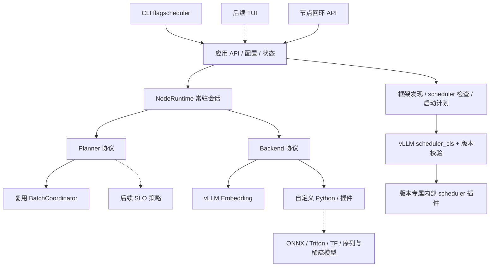

# FlagScheduler 架构与开发路线

## 定位与边界

FlagScheduler 是部署在单个计算节点上的推理请求衔接与调度程序。请求不需要知道模型由 vLLM、Python、ONNX、TF Serving 或其他运行时执行；模型特有的输入准备、实际成本计量、调用与输出解释由绑定的 Backend 完成。

本阶段不做跨节点路由、分布式资源调度、任意框架源码自动改写、运行中 scheduler 热替换、持久消息投递或完整 SLA 保证。设备发现不会自行占卡或推测硬件预算。

## 架构决策

有两个调度作用域，必须分别开发和衡量：

| 作用域 | 控制对象 | 扩展点 | 不承担的职责 |
| --- | --- | --- | --- |
| 节点级 Planner | 外层请求接纳、等待、兼容性、预算、批次、优先级 | `flagscheduler.planners` | vLLM 内部 KV/cache/抢占与迭代 |
| 框架内部 scheduler | vLLM 内部每次迭代、KV/cache 与运行队列 | `scheduler_cls`，版本专属插件 | 非 vLLM 框架的统一请求接入 |

动态组批和长度桶优先放在 Planner；依赖 vLLM token 迭代状态、KV/cache 的策略放在其内部插件。不要对同一延迟窗口叠加两套等待策略后归因于同一项性能收益。vLLM 原生优先级通常数值越小越先；本项目请求优先级数值越大越先。当前 vLLM Embedding 后端仅承接外层选择，没有把该优先级直接透传到内部队列。

## 代码布局与稳定接口

| 目录/模块 | 责任与约定 |
| --- | --- |
| `flagscheduler/cli.py` | 参数解析、JSON 输出、退出码；不实现组批算法 |
| `flagscheduler/discovery.py` | 受限范围扫描、跨 Python 只读探测、NVIDIA 清单 |
| `flagscheduler/deployment.py` | 精确版本、源码指纹、插件校验、可审查启动计划、原生回退 |
| `flagscheduler/catalog.py` | 原生脚本校验快照、自定义脚本注册、Default/Currently、持久选择 |
| `flagscheduler/contracts.py` | Request / ExecutionInput / ExecutionOutput / Backend / Planner |
| `flagscheduler/config.py` | `schema_version=1` JSON 配置与严格字段校验 |
| `flagscheduler/runtime.py` | 常驻生命周期、背压、异步接入、串行执行、ID 结果映射 |
| `flagscheduler/backends.py` | Mock 与真实 vLLM Embedding；执行插件装载 |
| `flagscheduler/server.py` | 回环 HTTP 协议适配，不承担跨节点路由 |
| `flagscheduler/integrations/` | 框架内部、版本专属 scheduler 扩展 |
| `dynamic_batching/` | 已有核心算法；继续维护其向后兼容性 |
| `sched_engine/` | 已有单次会话 API、旧画像与执行适配兼容入口 |

新应用/API 优先使用 `flagscheduler` 命名空间；不要再把长期运行逻辑塞进旧的单次 `SchedulerEngine.run()`。两者复用同一组批算法，不复制实现。

CLI/TUI 共享 `NodeRuntime.submit/snapshot/result/start/stop` 和控制面函数。TUI 以后可以直接调用 Python API，或通过节点 HTTP API 观察/提交；不应解析 CLI 终端文字，不把 UI 状态放进 Planner 或 Backend。

## 请求与执行生命周期

1. 配置把模型、任务、模型版本、执行后端、执行选项与策略组成显式 `binding`。
2. 接纳时校验 ID、binding、队列容量，用该后端同源的成本计量器获得整数成本。超过桶、预算或输入限制显式拒绝。
3. 一个 binding 对应一个策略/兼容 lane。模型版本和执行配置不混批；同一模型的不同实例也可用不同 binding 隔离。
4. Planner 在单一事件循环上更新。默认复用 `BatchCoordinator` 的分桶、批量/成本预算、等待兜底与优先级；优先级在兼容组内生效，不承诺跨 binding 的全局抢占。
5. 后端执行放到工作线程中；初版每节点只执行一个外层批次，避免自行引入未验证的设备并发。执行期间可继续接收请求。
6. 后端按 ID 返回结果。校验重复、漏项、未知 ID 和 JSON 可序列化性后再整批提交。异常令本批请求全部进入终态，无隐式重试。
7. SIGINT/SIGTERM 停止接纳，排空已接纳请求，关闭后端，退出进程。后端卡住时不提供硬超时抢占，部署监督器决定最终强制退出。

状态是进程内的：`active + result_history` 去重窗口内拒绝重复 ID，完成结果按配置数量淘汰。淘汰后 ID 可以再次使用。**不是**跨重启 exactly-once，不是持久队列。重启后客户端若重试，须结合业务幂等键。

客户端断开/取消等待不会取消已接受推理。`slo_ms` 转换成节点单调时钟 deadline 并交给 Planner/Backend；当前只保留元数据，不承诺准时完成，也不把 `max_wait_ms` 解释为 SLO。后续可扩展排队超期、估计运行时、抢占与服务降级，但要先定义各自的终态和验收口径。

结果缓存按请求数有界；批次观测保留最近 256 条，默认 Planner 关闭无限历史 ID 保留。大 payload/结果、连接数及多实例资源隔离仍需在生产化阶段按负载增加字节级预算和连接准入。

## 十五类模型的适配矩阵

表中的“候选执行方式”来自需求图，用于确定后续适配方向；当前仅作契约声明，不意味着这些后端已经实现或验证。

| 模型合同名 | 具体标识/系列 | 任务 | 计量单位 | 输出契约 | 候选执行方式 |
| --- | --- | --- | --- | --- | --- |
| Qwen3-Embedding-0.6B | Qwen/Qwen3-Embedding-0.6B | embed | token_length | 向量 | vLLM / Transformers |
| BGE | BAAI/bge-large-zh-v1.5 | embed | token_length | 向量 | Sentence-Transformers / TEI / ONNX |
| Jina-Embedding | jinaai/jina-embeddings-v3 | embed | token_length | 按任务/维度配置的向量 | Transformers / ONNX |
| Qwen3-Reranker | Qwen/Qwen3-Reranker-0.6B | rerank | token_length | 相关性分数 | vLLM / 专属打分适配器 |
| BGE-Reranker | BAAI/bge-reranker-large | rerank | token_length | 相关性分数 | Transformers / ONNX / TEI |
| DIN | 具体权重/特征版本待绑定 | predict | sequence_length | CTR | Python / ONNX / Triton |
| DIEN | 同上 | predict | sequence_length | CTR | Python / ONNX |
| DeepFM | 同上 | predict | nnz | CTR | CPU / ONNX / TF Serving |
| DCN | 同上 | predict | nnz | CTR/分类分数 | CPU / ONNX / Triton |
| ESMM | 同上 | predict | sample_count | 多头输出 | Python / 多头服务 |
| Wide & Deep | 同上 | predict | nnz | 排序概率 | TF Serving / ONNX |
| DLRM | 同上 | predict | nnz | 事件概率 | TorchRec / HugeCTR / Triton |
| PLE | 同上 | predict | sample_count | 多任务输出 | Python / 多头服务 |
| BST | 同上 | predict | sequence_length | CTR/排序分数 | ONNX / TensorRT |
| MMoE | 同上 | predict | sample_count | 多任务输出 | ONNX / Triton / Merlin |

文本对的联合分词、reranker 的 yes/no logit 处理、Jina task adapter、特征服务、稀疏 ID 校验、归一化、多头输出名等都属于具体 Backend 的职责。不能把 `LLM.embed` 直接用于 reranker，也不能要求全部模型输出同一种向量。Mock 提供演示输出，仅用于验证协议和调度。

旧模型画像中的 `verified` 是既有 Ascend 路径的历史兼容标签；新 runtime 的 binding 声明不自动获得 NVIDIA 认证。新的真实支持必须记录“模型权重/版本 × 框架版本 × 平台 × 后端版本 × 输入模式”的验证证据。

## 框架发现与替换规则

默认探测当前 Python、PATH 中 Python、激活的 venv/Conda 环境、Conda 环境注册表、默认 envs 的直接子目录；可用 `--python` 与 `--env-root` 补充其他用户指定环境。不会递归扫描整个文件系统，也不会自动进入容器。容器内应运行同一 discover 命令。

探测子进程只读取包规范、发行版元数据和源码 AST，不导入 vLLM/torch。显示候选 scheduler 路径和默认选择依赖的同步/异步分支，不能据此声称已知某个运行中进程的实际 scheduler。

替换通过新进程的 `scheduler_cls` 参数完成。自定义类要求精确 vLLM 版本、V1 扩展字段、可导入的类、当前安装 `SchedulerInterface` 子类、非抽象及构造签名可绑定；启动前复核源码指纹。静态计划不是 GPU 验收，插件导入校验也不证明 KV/cache 与抢占算法正确。

原生回退是生成计划中不带自定义 scheduler 的 `native_argv`，仍需另启进程；不会自动切换或重启现有服务。版本专属插件当前只允许 vLLM 0.21.0 并继承原生行为。

脚本目录为所有发现的原生脚本留存只读内容快照，以 Default 标记原生脚本，Currently 标记后续启动的持久选择。选择按环境、安装指纹与同步/异步模式隔离。节点启动和计划生成默认读取该选择；单次显式覆盖不改变持久选择。TUI 复用 `SchedulerCatalog.view/select/add`，运行中 binding 状态另行展示启动时 scheduler 配置。

## 分阶段路线与出口

| 阶段 | 工作 | 出口 |
| --- | --- | --- |
| P0 当前骨架 | CLI、发现、计划、节点 runtime、插件协议、15 模型 mock、旧接口恢复 | 离线测试、可复现 CLI/API 演示 |
| P1 NVIDIA 真机 | 固定模型权重和 GPU、原生/自定义 scheduler、直接/统一入口对照 | 请求不漏不重、数值容差、进程退出无残留、GPU 预算记录 |
| P2 任务后端 | 先具体 embedding/rerank，再选一个序列模型和一个稀疏模型 | 每个后端的同源计量、特征校验、输出契约与设备证据 |
| P3 策略 | 以测量数据决定长度桶、优先级、SLO admission/EDF/运行时估计 | 硬预算、低流量、不饥饿、同负载 A/B 与时延目标 |
| P4 运维/TUI | 只读监控先行，再加配置操作；字节级限额、连接准入、进程监督 | UI 无业务算法、可审查配置变更、重启/失败语义明确 |

P0 的完成不表示 P1–P4 已完成。优先开发真实需求的最小路径，不为尚无数据的模型/平台预实现策略。

## 长期维护规则

- 配置和 API 都保留 `schema_version`；破坏性改动递增版本并提供迁移说明，不静默改变含义。
- Backend、Planner 的变动分别跑契约测试；核心变动保留既有 117 项回归。新增硬件/框架支持附独立真机证据。
- `pyproject.toml` 将控制面依赖维持为标准库；vLLM、CUDA、ONNX 等留在各自执行环境，避免把所有框架装进 CLI 基础环境。
- 每次 vLLM 升级单独核对接口/源码指纹、同步/异步路径、signature、模型数值、KV/cache/抢占回归。不要去掉精确版本检查来“修复”升级。
- 实验结果放 `artifacts/` 或带独立名称的 benchmark 结果；不覆盖历史原始证据。不输出 payload、特征数据或凭据到批次日志。
- 所有项目文件修改、临时文件和产物都留在 `batch_yxy/`；外部环境仅只读检查。真实部署的安装、进程启动与设备分配应按明确任务另行执行。
