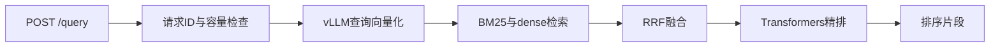

# 实现结构

主实现位于 `src/rag_engine/`，脚本负责初始化、CLI 与评测。

## 源码导航

| 模块 | 作用 |
|---|---|
| [query_runtime.py](../src/rag_engine/query_runtime.py) | API/CLI共享 pipeline 初始化与结果格式化 |
| [pipeline.py](../src/rag_engine/pipeline.py) | embed → search → rank 阶段接口 |
| [server.py](../src/rag_engine/server.py) | FastAPI、多请求接入、独立阶段推进与容量管理 |
| [scheduler.py](../src/rag_engine/scheduler.py) | embedding/retrieval/rerank有界FIFO队列、消费与背压 |
| [vllm_embedding.py](../src/rag_engine/vllm_embedding.py) | 默认文档/查询向量化，通过本地tokenizer发送token IDs到vLLM |
| [reranker.py](../src/rag_engine/reranker.py) | Qwen3-Reranker-0.6B Transformers精排 |
| [retrieval.py](../src/rag_engine/retrieval.py) | BM25/dense顺序或并发检索、RRF融合 |
| [stores/](../src/rag_engine/stores/) | Elasticsearch/Milvus统一接口；支持内置BM25与dense |
| [documents.py](../src/rag_engine/documents.py) / [ingestion.py](../src/rag_engine/ingestion.py) | 固定chunk ID、分块、逐批双库写入 |
| [device.py](../src/rag_engine/device.py) | device-context设备选择、可见性验证与dtype |
| [memory_probe.py](../src/rag_engine/memory_probe.py) | device-context内存探测、独立线程采样与缓存状态 |
| [benchmark.py](../src/rag_engine/benchmark.py) / [timing.py](../src/rag_engine/timing.py) | 测量、CSV/JSON记录与耗时汇总 |

## 查询流程与调度

每个已接收请求是独立 asyncio task，完成当前阶段即可进入下一阶段；无需
等待同批其他请求。默认 `max_inflight=8`，统计执行中及等待的工作。容量满时
返回503与 `Retry-After: 1`。`X-Request-ID` 与stage日志用于核对请求归属。

三个阶段分别使用显式有界FIFO队列，默认每个队列有8个等待槽。vLLM embedding
默认2个HTTP worker，可同时提交请求给引擎；tokenizer操作短暂加锁，HTTP等待不占
精排线程。检索默认4个worker；精排1个worker，继续在模型初始化线程执行。
本地Transformers embedding仍使用初始化线程，避免改变加速器线程绑定。

全局 `max_inflight=8` 包含执行、队列和等待队列空间的请求。阶段队列满时，已接收
请求等待空间；全局容量满时新请求返回503。worker可用即派发，无额外凑批等待。
同一请求的 sparse/dense 可在常驻两线程池内并发。HTTP取消后已接收的工作
继续完成并占用容量，关闭服务时先排空请求和阶段工作，再关闭pipeline。

`/health` 返回每个阶段的capacity、queued、running和workers，并标识真实数据库
与检索execution_mode。stage日志保存request ID及排队耗时。跨请求embedding HTTP
重叠可证明提交并发；是否同一次引擎forward合批须另查vLLM调度证据。精排目前仍
只对同一请求的候选文档合批，尚未实现跨请求精排batch dispatcher。

## 模型与数据库约定

- 文档和查询默认使用同一vLLM embedding模型，1024维；查询添加固定instruction，文档保留原文。
- vLLM是NPU容器中的独立pooling进程，通过8089 HTTP提供向量；精排由API进程执行。
- Elasticsearch默认standard analyzer；Milvus启用内置analyzer和BM25 function。中文分词需配置合适analyzer并重建索引。
- 检索默认每路50条、RRF常数60、融合后30条；API默认精排返回5条。
- 文档、chunk与请求标识贯穿流程；接口返回结果片段，生成模型待接入。

入库和查询必须使用一致的模型、维度、预处理和引擎配置。vLLM与Transformers
在BF16下可生成稍有不同的向量；相似向量并不保证完全相同的近邻排名。

## 当前限制

接入容量按请求数量控制，尚无基于主机/NPU内存的动态准入策略。当前是单进程
原型；最新状态、验证边界及后续工作见项目根目录 [status.md](../status.md)。
